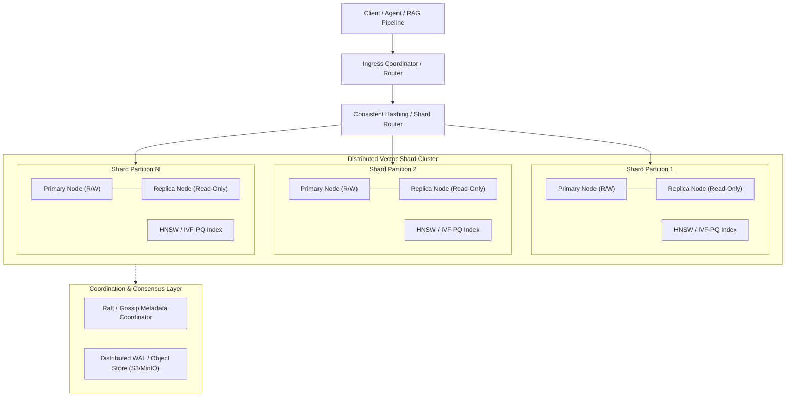

# Awesome Real-Time Vector Database Sharding ⚡

  

  
  
  
  
  
  
  

---

## 📌 Executive Summary & Introduction

Welcome to the definitive curated directory for **Real-Time Vector Database Sharding**, high-throughput distributed Approximate Nearest Neighbor (ANN) search, and enterprise-grade vector infrastructure.

As modern Generative AI, Retrieval-Augmented Generation (RAG), and agentic workflows expand from millions to **billions of high-dimensional embeddings**, single-node in-memory vector databases hit insurmountable memory and latency ceilings. **Real-time vector database sharding** solves this bottleneck by distributing vector embeddings, HNSW/IVF graphs, and inverted keyword indexes across clustered compute and storage nodes with low latency, Raft consensus, dynamic shard rebalancing, and high-availability replica routing.

This repository tracks production-proven **SaaS Platforms** and battle-tested **Open-Source GitHub Projects** engineered to provide horizontal scalability, sub-millisecond query latencies, and high write throughput for mission-critical AI applications.

---

## 📑 Table of Contents

- [📊 Sector Overview & Market Dynamics](#-sector-overview--market-dynamics)
- [☁️ SaaS / Managed Cloud Platforms](#️-saas--managed-cloud-platforms)
- [🐙 Open-Source GitHub Projects](#-open-source-github-projects)
- [🧩 Algorithmic Frameworks & Custom Sharding](#-algorithmic-frameworks--custom-sharding)
- [🏗️ Architectural Reference Patterns](#️-architectural-reference-patterns)
- [⭐ Star History](#-star-history)
- [💖 Support & Sponsoring](#-support--sponsoring)
- [🤝 How to Contribute](#-how-to-contribute)
- [📜 Disclaimer](#-disclaimer)

---

## 📊 Sector Overview & Market Dynamics

The global vector database and real-time distributed vector search market was valued at approximately **$1.8 billion in 2025** and is projected to expand to **over $8.5 billion by 2030**, growing at a staggering CAGR of ~36% fueled by widespread enterprise RAG (Retrieval-Augmented Generation), multimodal AI systems, and agentic memory architectures. 

The sector exhibits **moderate fragmentation with emergent concentration around ecosystem pillars** — while pioneering specialized engines (Pinecone, Milvus, Qdrant, Weaviate) capture substantial developer mindshare and high-throughput production workloads, full-text and relational stalwarts (PostgreSQL/pgvector, Elasticsearch, ClickHouse) continue capturing hybrid deployments, preventing a strictly "winner-take-all" outcome and driving intense competition across dynamic shard rebalancing and low-latency distributed ANN recall.

---

## ☁️ SaaS / Managed Cloud Platforms

The following table provides a comprehensive overview of managed SaaS vector platforms featuring horizontal sharding, dynamic partition allocation, and serverless scalability. Entries are **sorted descending by company valuation / scale**.

| Platform | Company Valuation / Revenue | Starting Tier Pricing | Free Tier Limits / Trial | Sharding & Real-Time Distributed Architecture |
| :--- | :--- | :--- | :--- | :--- |
| **[Pinecone](https://www.pinecone.io/)** | **$750M Valuation** (Series B, a16z; ~$35M+ ARR) | **$0.33 per 1M write units / $0.10 per 1M read units** + $0.25/GB-mo storage (Serverless pay-as-you-go) or Standard Pods from **$0.04/hour (~$29.00/mo)** | **Starter Plan (Free Forever)**: 1 project, 5 serverless indexes, up to 2 GB storage (~100,000 vectors with 768 dimensions), 100K read/write units/month; no credit card required | Decoupled compute and blob storage architecture with automatic background shard splitting, instant scaling, and multi-AZ replica consistency. |
| **[Zilliz Cloud (Milvus)](https://zilliz.com/)** | **$600M Valuation** ($113M raised; Series B+ led by Prosperity7) | **$0.05 per 1M read query units & $0.05/GB-mo** (Serverless) or Dedicated CU instances from **$0.088/hour (~$65.00/mo per CU)** | **Free Forever Tier**: 2 collections, 1 CU capacity (~1M vectors, 5GB storage); plus **$100 in free trial credits for 30 days** on enterprise clusters | Disaggregated cloud-native Milvus topology; stateless query/data coordinators partitioned across multi-node Kubernetes clusters with S3/MinIO segment storage. |
| **[Weaviate Cloud](https://weaviate.io/)** | **$200M Valuation** ($67M raised; Series B led by Index Ventures) | **$0.0175 per 1K query requests + $0.00014 per 1K vector dimensions/month** (Serverless) or Dedicated Clusters from **$25.00/month** | **Free Forever Tier**: Includes **$10 recurring monthly usage credits** on Serverless; plus a **14-day free Sandbox cluster** (up to 500K vectors, no credit card required) | Horizontal multi-shard distribution with configurable shard count and replica sets, gossip-based cluster coordination, and automatic distributed rebalancing. |
| **[Qdrant Cloud](https://qdrant.tech/cloud/)** | **$175M Valuation** ($38M raised; Series A led by Spark Capital) | **$0.0125/hour (~$9.00/month)** for a 0.5 vCPU, 1 GB RAM cluster (Dedicated Cloud) | **Free Forever Cluster**: 1 cluster with 0.5 vCPU, 1 GB RAM, up to ~150K 768-dim vectors, full REST/gRPC API; no credit card required | Rust-native distributed architecture using Raft consensus for topology state, peer-to-peer shard transfers, dynamic partition splitting, and payload-aware filtering. |
| **[Vespa Cloud](https://vespa.ai/)** | **$120M Valuation** ($31M raised; Series A led by Blossom Capital) | **$0.014/CPU core-hour + $0.0019/GB-RAM hour** (minimal dev cluster starts at **~$29.00/month**) | **Free 30-day trial** with **$300 in free cloud credits** to evaluate multi-node clusters and real-time hybrid vector search | Enterprise cluster architecture supporting millions of queries per second, stateful multi-tier storage grouping, and native HNSW + BM25 hybrid sharding. |
| **[Chroma Cloud](https://www.trychroma.com/)** | **$75M Valuation** ($20M raised; Seed led by Quiet Capital) | **$0.10 per 1M write units + $0.05 per 1M read units**; baseline production cluster starts at **$10.00/month** | **Free Forever Plan**: 1 GB storage, up to 1M vectors, 10M API requests/month included with full client support; no credit card required | Serverless distributed log architecture using decoupled metadata queries, cloud-native tenant isolation, and managed auto-scaling endpoints. |
| **[Marqo Cloud](https://www.marqo.ai/)** | **$55M Valuation** ($17.8M raised; Series A led by Lightspeed) | Entry-level dedicated inference and search worker node starting at **$0.03/hour (~$21.60/month)** | **Free 14-day trial** with **$50 in trial compute and storage credits** for multimodal vector embedding and search | Cloud-native tensor search with horizontal shard replication, asynchronous vector index construction, and multi-modal tensor sharding. |
| **[Turbopuffer](https://turbopuffer.com/)** | **$25M Valuation** ($11M raised; Seed/Series A led by Peak XV) | **$0.000000003 per vector dimension queried** (~$3.00 per 1B vector dimensions searched) + **$0.02/GB storage/month** | **Free Forever Tier**: 100M free vector dimensions searched per month and up to 1 GB cloud storage free | Object-storage-backed vector search engine using stateless ephemeral compute nodes and distributed partitioning directly over cloud blob stores. |
| **[MyScale](https://myscale.com/)** | **$18M Valuation** (Seed stage; MoInternal) | **$0.068/hour (~$49.00/month)** for a Standard Pod (2 vCPUs, 8 GB RAM) | **Free Developer Pod (Free Forever)**: 1 pod with up to 5M 768-dim vectors storage; or 30-day enterprise evaluation trial | Distributed SQL vector database built atop ClickHouse with MSTG vector index algorithm, high-throughput column-oriented sharding, and real-time streaming ingestion. |
| **[Typesense Cloud](https://typesense.org/)** | **$15M Valuation** (Bootstrapped / ~$3.5M ARR) | Dedicated cluster starting at **$0.025/hour (~$18.00/month)** for a 0.5 vCPU, 1 GB RAM high-performance node | **Free 30-day trial** with **$50 in free cloud credits** to deploy single-node or multi-node distributed clusters | Raft-based distributed clustering, typo-tolerant keyword + vector hybrid sharding, and sub-50ms distributed search execution. |

---

## 🐙 Open-Source GitHub Projects

This section catalogs leading open-source distributed vector databases, sharding frameworks, and ANN engines. Entries are **sorted descending by GitHub Stars_Count**, with real-time badges linking directly to each repository's stargazers page.

### 1. [Milvus](https://github.com/milvus-io/milvus) 
- **Primary Language**: Go / C++
- **License**: Apache 2.0
- **Sharding & Scaling Architecture**: The industry-standard distributed vector database engineered for billion-scale vector workloads. Employs a cloud-native disaggregated design separating stateless compute coordinators (RootCoord, QueryCoord, DataCoord) from storage segments (S3/MinIO, etcd, Pulsar/Kafka write-ahead log). Features independent query node and data node scaling with automated segment compaction and shard rebalancing across Kubernetes clusters.

### 2. [FAISS](https://github.com/facebookresearch/faiss) 
- **Primary Language**: C++ / Python
- **License**: MIT
- **Sharding & Scaling Architecture**: Facebook AI Research's fundamental library for efficient similarity search and dense vector clustering. Offers state-of-the-art IVF, HNSW, PQ, and GPU-accelerated algorithms. Serves as the core indexing engine within distributed vector shard nodes across numerous enterprise database engines.

### 3. [Qdrant](https://github.com/qdrant/qdrant) 
- **Primary Language**: Rust
- **License**: Apache 2.0
- **Sharding & Scaling Architecture**: High-performance Rust-based vector search engine with native distributed clustering. Utilizes Raft consensus for cluster metadata, dynamic shard transfers between nodes without downtime, payload-based filtering, and hybrid dense/sparse vector search with sub-millisecond p99 latencies.

### 4. [Chroma](https://github.com/chroma-core/chroma) 
- **Primary Language**: Python / Rust
- **License**: Apache 2.0
- **Sharding & Scaling Architecture**: Developer-first open-source embedding database optimized for rapid RAG application iteration. Features a modular architecture supporting embedded local runtimes as well as distributed cloud-native segments backed by decoupled metadata catalogs and distributed log streams.

### 5. [Typesense](https://github.com/typesense/typesense) 
- **Primary Language**: C++
- **License**: GPL-3.0
- **Sharding & Scaling Architecture**: Fast, typo-tolerant search engine with native vector search and hybrid search capabilities. Uses Raft-based distributed clustering for high availability and automated shard distribution, allowing seamless concurrent keyword and embedding queries.

### 6. [pgvector](https://github.com/pgvector/pgvector) 
- **Primary Language**: C
- **License**: PostgreSQL License
- **Sharding & Scaling Architecture**: Open-source vector similarity search extension for PostgreSQL. Enables HNSW and IVFFlat indexing directly on relational tables. Scales horizontally when paired with PostgreSQL distributed clustering tools (such as Citus) or cloud-native distributed Postgres architectures.

### 7. [Weaviate](https://github.com/weaviate/weaviate) 
- **Primary Language**: Go
- **License**: BSD-3-Clause
- **Sharding & Scaling Architecture**: Open-source, cloud-native vector database with built-in multi-shard distribution. Operators configure dynamic shard and replica counts per collection; Weaviate automatically manages data partitioning, eventual consistency synchronization, and hybrid BM25 + dense vector ranking.

### 8. [OpenSearch (k-NN)](https://github.com/opensearch-project/OpenSearch) 
- **Primary Language**: Java
- **License**: Apache 2.0
- **Sharding & Scaling Architecture**: Distributed search engine featuring the native k-NN plugin powered by FAISS and NMSLIB. Vectors are partitioned across primary and replica shards across distributed cluster nodes, inheriting mature enterprise sharding, reindexing, and shard-routing mechanisms.

### 9. [LanceDB](https://github.com/lancedb/lancedb) 
- **Primary Language**: Rust
- **License**: Apache 2.0
- **Sharding & Scaling Architecture**: Embedded and serverless vector database built on the columnar Lance data format. Decouples compute from persistent storage (S3/GCS/local NVMe), enabling zero-copy partition scans, fast vector indexing, and seamless integration with distributed compute frameworks like Apache Arrow and Ray.

### 10. [Vespa](https://github.com/vespa-engine/vespa) 
- **Primary Language**: C++ / Java
- **License**: Apache 2.0
- **Sharding & Scaling Architecture**: Yahoo's battle-proven distributed search engine for vector, lexical, and structured search at billion-scale. Distributes data across stateful content clusters with automatic shard rebalancing, real-time index mutations, and multi-phase machine learning ranking.

### 11. [Marqo](https://github.com/marqo-ai/marqo) 
- **Primary Language**: Python
- **License**: Apache 2.0
- **Sharding & Scaling Architecture**: End-to-end multimodal vector search engine with native horizontal sharding. Handles document preprocessing, embedding inference, HNSW indexing, and distributed query execution across multi-node clusters.

### 12. [Infinity](https://github.com/infiniflow/infinity) 
- **Primary Language**: C++
- **License**: Apache 2.0
- **Sharding & Scaling Architecture**: AI-native vector and full-text database built from scratch for LLM workflows. Offers sub-millisecond hybrid retrieval across dense vectors, sparse embeddings, and full-text queries with SIMD-accelerated execution and distributed clustering.

### 13. [RuVector](https://github.com/ruvnet/RuVector) 
- **Primary Language**: Rust / Python
- **License**: MIT
- **Sharding & Scaling Architecture**: High-speed vector engine featuring automatic sharding via consistent hashing, dynamic shard migration, Raft-based metadata consensus, multi-master replication, and hot/warm/cold memory tiering.

### 14. [USearch](https://github.com/unum-cloud/usearch) 
- **Primary Language**: C++
- **License**: Apache 2.0
- **Sharding & Scaling Architecture**: Compact and ultra-fast vector search library designed for native hardware acceleration (AVX-512, ARM NEON, FP16/INT8 quantization). Ideal as a high-density, low-overhead indexing engine embedded within custom distributed shard partitions.

### 15. [pgvecto.rs](https://github.com/tensorchord/pgvecto.rs) 
- **Primary Language**: Rust
- **License**: Apache 2.0
- **Sharding & Scaling Architecture**: Scalable, high-performance vector search extension for PostgreSQL written entirely in Rust. Implements Vamana and HNSW graph indexes with asynchronous index construction, SIMD optimizations, and seamless compatibility with Postgres horizontal partitioning.

### 16. [DiskANN](https://github.com/microsoft/DiskANN) 
- **Primary Language**: C++
- **License**: MIT
- **Sharding & Scaling Architecture**: Microsoft Research's graph-based approximate nearest neighbor search algorithm designed to query billions of vectors directly from SSDs/NVMe storage while keeping RAM usage minimal. Frequently integrated into distributed vector nodes to maximize vector density per machine.

### 17. [Vald](https://github.com/vdaas/vald) 
- **Primary Language**: Go
- **License**: Apache 2.0
- **Sharding & Scaling Architecture**: Cloud-native distributed ANN dense vector search engine built from the ground up for Kubernetes. Employs the NGT algorithm with autonomous indexing agents, dynamic horizontal pod autoscaling, and distributed ingress load balancing.

---

## 🧩 Algorithmic Frameworks & Custom Sharding

For engineering teams constructing proprietary distributed vector topologies or custom scatter-gather architectures:

- **[VecGrid](https://pypi.org/project/vecgrid/)**: Distributed HNSW framework utilizing partitioned graphs (default 271 partitions via consistent hashing of vector IDs). Uses scatter-gather queries with coordinator merging to maintain 95–98% recall@10 at multi-million scale.
- **[HAKES](https://arxiv.org/abs/2505.12524)**: Hybrid Approximate Nearest Neighbor with Key-Enabled Sharding for distributed vector databases, achieving up to 0.98 recall for top-k retrieval across sharded clusters.
- **[NodeDB](https://crates.io/crates/nodedb-bridge)**: Distributed multi-modal database in Rust combining Vector, Graph, Columnar, and Key-Value engines with multi-Raft consensus, Thread-per-Core io_uring data planes, and automatic shard balancing.

---

## 🏗️ Architectural Reference Patterns

When designing a production-grade real-time vector sharding pipeline, consider the following best practices:

1. **Scatter-Gather vs. Directed Routing**:
   - For high-dimensional embeddings without metadata filters, queries are scattered to all primary shards and partial results are merged by the coordinator.
   - For multi-tenant or categorical workloads, partition keys (e.g. `tenant_id` or `workspace_id`) route queries directly to target shards, drastically reducing cluster network overhead.
2. **Dynamic Shard Splitting & Rebalancing**:
   - Implement consistent hashing rings with virtual nodes to avoid massive reindexing cascades when adding capacity.
   - Hot/cold tiering (e.g., in-memory HNSW for recent vectors, DiskANN/SSD-backed indexes for cold vectors) reduces memory expenses by up to 80%.
3. **Consensus & High Availability**:
   - Decouple cluster metadata consensus (Raft/etcd) from vector ingestion pipelines (WAL / Pulsar / Kafka) to maintain 99.99% availability during shard failovers.

---

## ⭐ Star History

---

## 💖 Support & Sponsoring

Thank you for visiting and using **Awesome Real-Time Vector Database Sharding**! If this curated guide helped you navigate distributed vector indexing, RAG system scaling, or choosing the best sharding engine for your workloads:

- ⭐ **Star this repository** to show your appreciation and help more developers discover it.
- 🍴 **Fork and contribute** by submitting PRs with new projects, benchmarks, and architectural insights.
- 📢 **Share** with your engineering team, AI research group, and developer networks.
- ☕ **Sponsor & Buy a Coffee**: Support maintenance and updates directly via the [GitHub Sponsors Dashboard](https://github.com/sponsors/ishandutta2007).

---

## 🤝 How to Contribute

We welcome contributions from the community! To suggest a new SaaS product, open-source project, or architectural enhancement:

1. **Fork** this repository.
2. **Create a branch**: `git checkout -b feature/add-new-sharding-engine`.
3. **Add your entry** under the appropriate section in `README.md` (ensure factual descriptions, valid links, specific pricing/free limits for SaaS, or Stars_Badges for open source).
4. **Submit a Pull Request** with a concise description of why the tool should be included.

---

## 📜 Disclaimer

- This list is **community-curated** for educational, architectural, and evaluation purposes; inclusion does not constitute an endorsement.
- All product names, logos, and brands are property of their respective owners.
- Real-time recall, latency, and throughput numbers are highly dependent on dimensionality, distance metrics, quantization methods, and hardware infrastructure. Always benchmark with your application's actual data distribution.

---

  <b>Built with ❤️ for AI Engineers, Distributed Systems Architects, and High-Throughput RAG Developers.</b>

